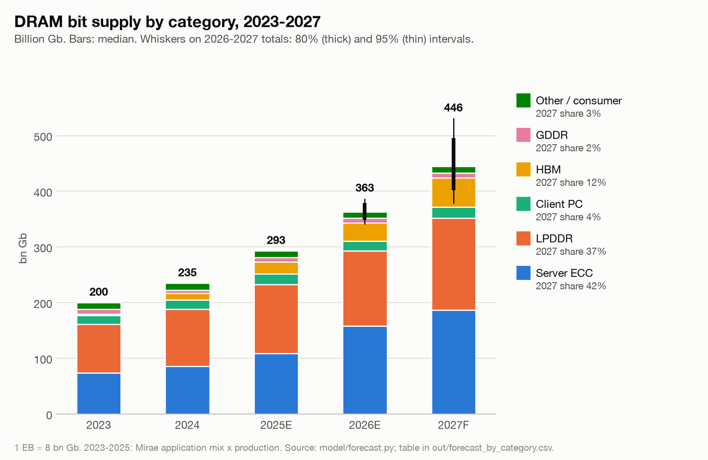
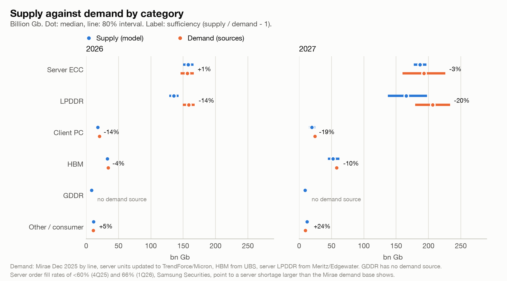
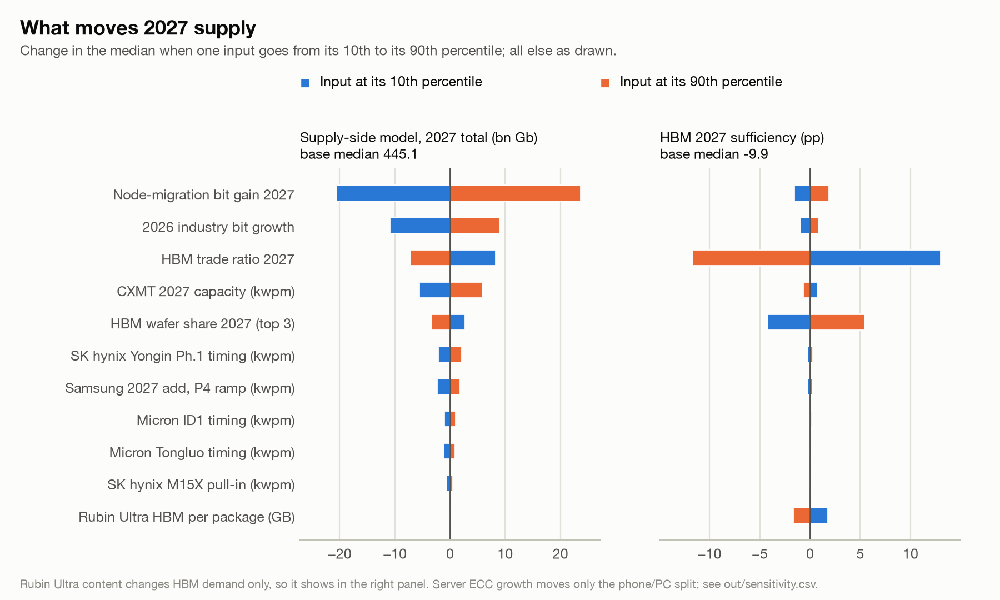
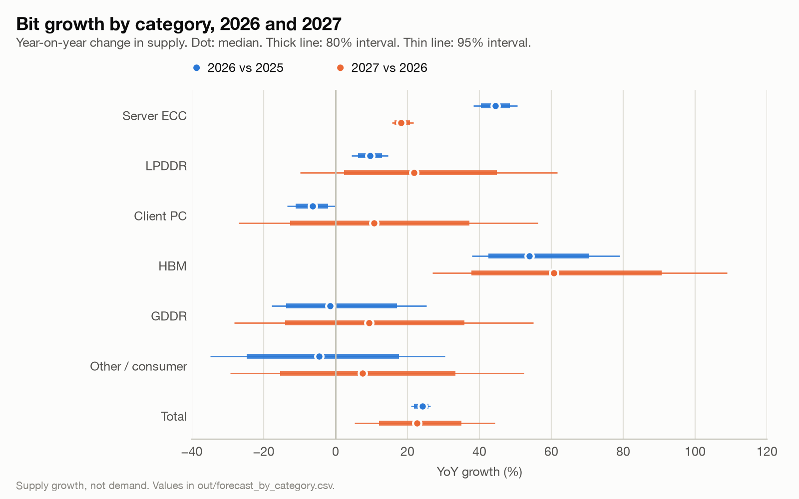

# DRAM production and supply chain in 2026, and the 2027 outlook, by memory category

**Status: DRAFT, 2026-10-30. Model numbers come from model/forecast.py (50,000 draws, seed 20261030).** All other numbers come from the source CSV files in `sources/`.

**How to read this document**

- Each source figure has a tag: actual, estimate, forecast or derived, and the publish date of the source, for example "(forecast, 2025-12-15)". Where two vintages exist, this document uses the latest one.
- "Derived" means that this document calculated the value from cited figures. The formula is given in the text.
- "Model" means an output of `model/forecast.py`. The text names the file in `out/` that holds it.
- "(per source summary)" means that the cited row's quote does not hold the statement. The statement comes from the summary that the research pass wrote for that row.
- Units: "bn Gb" means billion gigabits. 1 EB = 10^9 GB = 8 bn Gb. "kwpm" means thousand 300 mm wafers per month.
- Bracket numbers such as [3] point to Section 7. Section 7 marks sources that came only from a search summary, or that are paywalled and seen only in summary.

---

## 1. Summary

### 1.1 Main points

1. **Total supply grows about 24% in 2026, and the market is still short.** The model gives {{M:total:2026:median_bnGb}} bn Gb ({{M:total:2026:median_EB}} EB), {{M:total:2026:yoy_pct}} on 2025. TrendForce puts the 2026 sufficiency ratio at −1% to −2% [[!td:18]].
2. **Servers and HBM take most new bits.** HBM plus RDIMM is 51% of 2026 DRAM bit supply [[!sd:224]]. Server DRAM without HBM is 41.0% of 2026 bit demand for Mirae [[!sd:20]] and 47% for KGI [[!sd:82]].
3. **HBM takes wafers out of all other categories.** HBM is 22% of DRAM wafer input at end-2026 but only 9% of bits [[!hg:10|hg:7]]. At end-2027 these values are 30% and 13% [[!hg:11|hg:8]]. This is the main reason why conventional DRAM stays short in 2027 (Section 3.3).
4. **Contract prices rose fastest in 1H26, and the rise now slows.** Conventional DRAM contract prices rose 93–98% in 1Q26 [[!sc:18]] and 58–63% in 2Q26 [[!sc:19]]. TrendForce expects 13–18% in 3Q26 [[!sc:20]] and 10–15% in 4Q26 [[!sc:21]].
5. **New cleanroom space adds little bit output in 2027.** Substantial output from new fabs comes only in 2028 [[!sc:136]]. The model gives 2027 total growth of {{M:total:2027:yoy_pct}}, inside the published range of low 20s % (Micron) [[!td:3]] to mid-20s % (SK hynix) [[!td:125]].
6. **Long-term agreements lock most 2027 supply.** SK hynix has LTAs for more than 50% of its 2027–2028 capacity [[!sc:102]]. Micron has more than 75% of its 2027 output committed [[!sd:235]]. Customers booked about 80% of Samsung's planned 2027 memory output (KB Securities estimate) [[!td:556]]. Buyers without LTAs pay most of the price increase [[!sc:109]].
7. **PCs and phones cut units and memory per device.** IDC expects PC shipments of −11.3% in 2026 [[!sd:251]] and smartphone shipments of −16.7% [[!lp:24]]. Low-end phones go back to 4 GB [[!sc:160]].
8. **The 2027 consensus is "tighter than 2026".** Views differ on duration (Samsung: into 2028 [[!td:485]]; SK hynix: through 2030 [[!td:126]]), about HBM per Rubin Ultra package [[!hg:252]], and about how much LPDDR5X goes to servers [[!lp:129]].

### 1.2 Summary table

The six buckets add to the total. DDR5 and DDR4 modules are overlays: they overlap Server ECC and Client PC, and they are not added. Section 6.2 gives the boundaries.

| Category | 2026 supply (bn Gb / EB) | Share of 2026 bits | 2026 YoY | 2027 projection, bn Gb [80% interval] | 2027 YoY | Main constraint | 2026 price trend |
|---|---|---|---|---|---|---|---|
| Total DRAM | {{M:total:2026:median_bnGb}} / {{M:total:2026:median_EB}} | 100% | {{M:total:2026:yoy_pct}} | {{M:total:2027:median_bnGb}} [{{M:total:2027:p10_bnGb}} to {{M:total:2027:p90_bnGb}}] | {{M:total:2027:yoy_pct}} | Cleanroom space; HBM wafer crowding [[sc:118|sc:135]] | Sharp rise in 1H26, slower in 2H26 (Section 4.1) |
| Server ECC (RDIMM, MRDIMM) | {{M:server-ecc:2026:median_bnGb}} / {{M:server-ecc:2026:median_EB}} | {{M:server-ecc:2026:share_pct}} | {{M:server-ecc:2026:yoy_pct}} | {{M:server-ecc:2027:median_bnGb}} [{{M:server-ecc:2027:p10_bnGb}} to {{M:server-ecc:2027:p90_bnGb}}] | {{M:server-ecc:2027:yoy_pct}} | RDIMM bits +15–20% in 2027 against server CPUs +>40% [[sd:226|sd:121]] | Server contract about +90% 1Q26, about +270% for 2026 (forecasts) [[sd:153|sd:160]] |
| Client PC (non-LP) | {{M:client-pc:2026:median_bnGb}} / {{M:client-pc:2026:median_EB}} | {{M:client-pc:2026:share_pct}} | {{M:client-pc:2026:yoy_pct}} | {{M:client-pc:2027:median_bnGb}} [{{M:client-pc:2027:p10_bnGb}} to {{M:client-pc:2027:p90_bnGb}}] | {{M:client-pc:2027:yoy_pct}} | Suppliers move capacity to servers [[td:560]] | PC DRAM contract more than +100% 1Q26 (forecast) [[sd:154]] |
| LPDDR (phone, tablet, PC, server, auto) | {{M:lpddr:2026:median_bnGb}} / {{M:lpddr:2026:median_EB}} | {{M:lpddr:2026:share_pct}} | {{M:lpddr:2026:yoy_pct}} | {{M:lpddr:2027:median_bnGb}} [{{M:lpddr:2027:p10_bnGb}} to {{M:lpddr:2027:p90_bnGb}}] | {{M:lpddr:2027:yoy_pct}} | Wafers moved to HBM and to server SOCAMM2 [[lp:144|lp:147]] | LPDDR5X +78–83% 2Q26; mobile +0–5% 4Q26 (forecasts) [[lp:154|lp:159]] |
| HBM | {{M:hbm:2026:median_bnGb}} / {{M:hbm:2026:median_EB}} | {{M:hbm:2026:share_pct}} | {{M:hbm:2026:yoy_pct}} | {{M:hbm:2027:median_bnGb}} [{{M:hbm:2027:p10_bnGb}} to {{M:hbm:2027:p90_bnGb}}] | {{M:hbm:2027:yoy_pct}} | DRAM wafers at a high trade ratio; TSV capacity (Section 3.3) | Annual contracts; HBM4 12-Hi 36 GB about 600 USD per stack [[hg:245]] |
| GDDR | {{M:gddr:2026:median_bnGb}} / {{M:gddr:2026:median_EB}} | {{M:gddr:2026:share_pct}} | {{M:gddr:2026:yoy_pct}} | {{M:gddr:2027:median_bnGb}} [{{M:gddr:2027:p10_bnGb}} to {{M:gddr:2027:p90_bnGb}}] | {{M:gddr:2027:yoy_pct}} | Suppliers exit GDDR6 [[hg:206]] | No 2026 contract % in text; RTX 50 card prices +19% in 3 months [[hg:287]] |
| Other / consumer | {{M:other-consumer:2026:median_bnGb}} / {{M:other-consumer:2026:median_EB}} | {{M:other-consumer:2026:share_pct}} | {{M:other-consumer:2026:yoy_pct}} | {{M:other-consumer:2027:median_bnGb}} [{{M:other-consumer:2027:p10_bnGb}} to {{M:other-consumer:2027:p90_bnGb}}] | {{M:other-consumer:2027:yoy_pct}} | Legacy lines leave the big three (Section 2.7) | DDR2 contract +55–60% 2Q26 (estimate) [[sc:41]] |
| DDR5 (overlay; not added) | {{M:ddr5:2026:median_bnGb}} / {{M:ddr5:2026:median_EB}} | {{M:ddr5:2026:share_pct}} | {{M:ddr5:2026:yoy_pct}} | {{M:ddr5:2027:median_bnGb}} [{{M:ddr5:2027:p10_bnGb}} to {{M:ddr5:2027:p90_bnGb}}] | {{M:ddr5:2027:yoy_pct}} | Same wafers as server and client; 1c node ramp [[td:496|td:503]] | DDR5 16Gb spot about 12.4× from Mar 2025 to Oct 2026 (derived) [[sc:84]] |
| DDR4 modules (overlay; not added) | {{M:ddr4-legacy:2026:median_bnGb}} / {{M:ddr4-legacy:2026:median_EB}} | {{M:ddr4-legacy:2026:share_pct}} | {{M:ddr4-legacy:2026:yoy_pct}} | {{M:ddr4-legacy:2027:median_bnGb}} [{{M:ddr4-legacy:2027:p10_bnGb}} to {{M:ddr4-legacy:2027:p90_bnGb}}] | {{M:ddr4-legacy:2027:yoy_pct}} | End of life at Samsung, SK hynix and Micron [[sd:139|sd:140|sd:141]] | DDR4 8Gb spot about 31.8× from Feb 2025 to Oct 2026 (derived) [[sc:83]] |

Total sufficiency (supply / demand − 1): {{M:total:2026:gap_pct}} in 2026 ({{M:total:2026:gap_bnGb}} bn Gb) and {{M:total:2027:gap_pct}} in 2027 ({{M:total:2027:gap_bnGb}} bn Gb).

### 1.3 Model results

Values in bn Gb. Intervals: 80% (p10–p90) and 95% (p2.5–p97.5) of the draws. Sufficiency: supply / demand − 1 [80% range]. Source: `out/forecast_by_category.csv`.

| Category | 2026 median | 2026 80% | 2026 95% | 2027 median | 2027 80% | 2027 95% | Sufficiency 2026 | Sufficiency 2027 |
|---|---|---|---|---|---|---|---|---|
| Server ECC | {{M:server-ecc:2026:median_bnGb}} | {{M:server-ecc:2026:p10_bnGb}}–{{M:server-ecc:2026:p90_bnGb}} | {{M:server-ecc:2026:p2_5_bnGb}}–{{M:server-ecc:2026:p97_5_bnGb}} | {{M:server-ecc:2027:median_bnGb}} | {{M:server-ecc:2027:p10_bnGb}}–{{M:server-ecc:2027:p90_bnGb}} | {{M:server-ecc:2027:p2_5_bnGb}}–{{M:server-ecc:2027:p97_5_bnGb}} | {{M:server-ecc:2026:suff_pct}} [{{M:server-ecc:2026:suff_p10_pct}}, {{M:server-ecc:2026:suff_p90_pct}}] | {{M:server-ecc:2027:suff_pct}} [{{M:server-ecc:2027:suff_p10_pct}}, {{M:server-ecc:2027:suff_p90_pct}}] |
| Client PC | {{M:client-pc:2026:median_bnGb}} | {{M:client-pc:2026:p10_bnGb}}–{{M:client-pc:2026:p90_bnGb}} | {{M:client-pc:2026:p2_5_bnGb}}–{{M:client-pc:2026:p97_5_bnGb}} | {{M:client-pc:2027:median_bnGb}} | {{M:client-pc:2027:p10_bnGb}}–{{M:client-pc:2027:p90_bnGb}} | {{M:client-pc:2027:p2_5_bnGb}}–{{M:client-pc:2027:p97_5_bnGb}} | {{M:client-pc:2026:suff_pct}} [{{M:client-pc:2026:suff_p10_pct}}, {{M:client-pc:2026:suff_p90_pct}}] | {{M:client-pc:2027:suff_pct}} [{{M:client-pc:2027:suff_p10_pct}}, {{M:client-pc:2027:suff_p90_pct}}] |
| LPDDR | {{M:lpddr:2026:median_bnGb}} | {{M:lpddr:2026:p10_bnGb}}–{{M:lpddr:2026:p90_bnGb}} | {{M:lpddr:2026:p2_5_bnGb}}–{{M:lpddr:2026:p97_5_bnGb}} | {{M:lpddr:2027:median_bnGb}} | {{M:lpddr:2027:p10_bnGb}}–{{M:lpddr:2027:p90_bnGb}} | {{M:lpddr:2027:p2_5_bnGb}}–{{M:lpddr:2027:p97_5_bnGb}} | {{M:lpddr:2026:suff_pct}} [{{M:lpddr:2026:suff_p10_pct}}, {{M:lpddr:2026:suff_p90_pct}}] | {{M:lpddr:2027:suff_pct}} [{{M:lpddr:2027:suff_p10_pct}}, {{M:lpddr:2027:suff_p90_pct}}] |
| – phone + tablet | {{M:lpddr-phone:2026:median_bnGb}} | {{M:lpddr-phone:2026:p10_bnGb}}–{{M:lpddr-phone:2026:p90_bnGb}} | {{M:lpddr-phone:2026:p2_5_bnGb}}–{{M:lpddr-phone:2026:p97_5_bnGb}} | {{M:lpddr-phone:2027:median_bnGb}} | {{M:lpddr-phone:2027:p10_bnGb}}–{{M:lpddr-phone:2027:p90_bnGb}} | {{M:lpddr-phone:2027:p2_5_bnGb}}–{{M:lpddr-phone:2027:p97_5_bnGb}} | {{M:lpddr-phone:2026:suff_pct}} [{{M:lpddr-phone:2026:suff_p10_pct}}, {{M:lpddr-phone:2026:suff_p90_pct}}] | {{M:lpddr-phone:2027:suff_pct}} [{{M:lpddr-phone:2027:suff_p10_pct}}, {{M:lpddr-phone:2027:suff_p90_pct}}] |
| – server LPDDR | {{M:lpddr-server:2026:median_bnGb}} | {{M:lpddr-server:2026:p10_bnGb}}–{{M:lpddr-server:2026:p90_bnGb}} | {{M:lpddr-server:2026:p2_5_bnGb}}–{{M:lpddr-server:2026:p97_5_bnGb}} | {{M:lpddr-server:2027:median_bnGb}} | {{M:lpddr-server:2027:p10_bnGb}}–{{M:lpddr-server:2027:p90_bnGb}} | {{M:lpddr-server:2027:p2_5_bnGb}}–{{M:lpddr-server:2027:p97_5_bnGb}} | {{M:lpddr-server:2026:suff_pct}} [{{M:lpddr-server:2026:suff_p10_pct}}, {{M:lpddr-server:2026:suff_p90_pct}}] | {{M:lpddr-server:2027:suff_pct}} (set by the 60% fill rule) |
| HBM | {{M:hbm:2026:median_bnGb}} | {{M:hbm:2026:p10_bnGb}}–{{M:hbm:2026:p90_bnGb}} | {{M:hbm:2026:p2_5_bnGb}}–{{M:hbm:2026:p97_5_bnGb}} | {{M:hbm:2027:median_bnGb}} | {{M:hbm:2027:p10_bnGb}}–{{M:hbm:2027:p90_bnGb}} | {{M:hbm:2027:p2_5_bnGb}}–{{M:hbm:2027:p97_5_bnGb}} | {{M:hbm:2026:suff_pct}} [{{M:hbm:2026:suff_p10_pct}}, {{M:hbm:2026:suff_p90_pct}}] | {{M:hbm:2027:suff_pct}} [{{M:hbm:2027:suff_p10_pct}}, {{M:hbm:2027:suff_p90_pct}}] |
| GDDR | {{M:gddr:2026:median_bnGb}} | {{M:gddr:2026:p10_bnGb}}–{{M:gddr:2026:p90_bnGb}} | {{M:gddr:2026:p2_5_bnGb}}–{{M:gddr:2026:p97_5_bnGb}} | {{M:gddr:2027:median_bnGb}} | {{M:gddr:2027:p10_bnGb}}–{{M:gddr:2027:p90_bnGb}} | {{M:gddr:2027:p2_5_bnGb}}–{{M:gddr:2027:p97_5_bnGb}} | no demand source | no demand source |
| Other / consumer | {{M:other-consumer:2026:median_bnGb}} | {{M:other-consumer:2026:p10_bnGb}}–{{M:other-consumer:2026:p90_bnGb}} | {{M:other-consumer:2026:p2_5_bnGb}}–{{M:other-consumer:2026:p97_5_bnGb}} | {{M:other-consumer:2027:median_bnGb}} | {{M:other-consumer:2027:p10_bnGb}}–{{M:other-consumer:2027:p90_bnGb}} | {{M:other-consumer:2027:p2_5_bnGb}}–{{M:other-consumer:2027:p97_5_bnGb}} | {{M:other-consumer:2026:suff_pct}} [{{M:other-consumer:2026:suff_p10_pct}}, {{M:other-consumer:2026:suff_p90_pct}}] | {{M:other-consumer:2027:suff_pct}} [{{M:other-consumer:2027:suff_p10_pct}}, {{M:other-consumer:2027:suff_p90_pct}}] |
| **Total** | {{M:total:2026:median_bnGb}} | {{M:total:2026:p10_bnGb}}–{{M:total:2026:p90_bnGb}} | {{M:total:2026:p2_5_bnGb}}–{{M:total:2026:p97_5_bnGb}} | {{M:total:2027:median_bnGb}} | {{M:total:2027:p10_bnGb}}–{{M:total:2027:p90_bnGb}} | {{M:total:2027:p2_5_bnGb}}–{{M:total:2027:p97_5_bnGb}} | {{M:total:2026:suff_pct}} [{{M:total:2026:suff_p10_pct}}, {{M:total:2026:suff_p90_pct}}] | {{M:total:2027:suff_pct}} [{{M:total:2027:suff_p10_pct}}, {{M:total:2027:suff_p90_pct}}] |
| DDR5 (overlay) | {{M:ddr5:2026:median_bnGb}} | {{M:ddr5:2026:p10_bnGb}}–{{M:ddr5:2026:p90_bnGb}} | {{M:ddr5:2026:p2_5_bnGb}}–{{M:ddr5:2026:p97_5_bnGb}} | {{M:ddr5:2027:median_bnGb}} | {{M:ddr5:2027:p10_bnGb}}–{{M:ddr5:2027:p90_bnGb}} | {{M:ddr5:2027:p2_5_bnGb}}–{{M:ddr5:2027:p97_5_bnGb}} | – | – |
| DDR4 modules (overlay) | {{M:ddr4-legacy:2026:median_bnGb}} | {{M:ddr4-legacy:2026:p10_bnGb}}–{{M:ddr4-legacy:2026:p90_bnGb}} | {{M:ddr4-legacy:2026:p2_5_bnGb}}–{{M:ddr4-legacy:2026:p97_5_bnGb}} | {{M:ddr4-legacy:2027:median_bnGb}} | {{M:ddr4-legacy:2027:p10_bnGb}}–{{M:ddr4-legacy:2027:p90_bnGb}} | {{M:ddr4-legacy:2027:p2_5_bnGb}}–{{M:ddr4-legacy:2027:p97_5_bnGb}} | – | – |

**What sufficiency means here.** Sufficiency compares model supply with a published demand view. A negative value means short. The total uses Mirae demand of 379.8 bn Gb (2026) and 462.1 bn Gb (2027) [[!td:140|td:141]]. The phone, tablet and PC demand also comes from Mirae's December 2025 view, which was made before the 2026 price rise. So the phone and PC gaps mostly show demand lost to price, not orders that wait for memory. The server gap is probably understated. Server order fill rates were below 60% in 4Q25 and 66% in 1Q26 [[!sd:220]]. Read the server sufficiency as an upper bound.

**How the model sets the 2027 total.** The model mixes three forecasts of 2027 growth (model, `out/combination_2027.csv`). A naive time-series model gives +24.1% [80%: 10.1% to 40.0%]. A supply model of wafers, HBM share, trade ratio and node gain gives +22.0% [16.2% to 29.2%]. Published guidance gives +22.4% [10.0% to 36.2%]. The model gives each forecast a weight of 1/3 and pools the draws. The result is +22.6% [12.1% to 35.0%], or {{M:total:2027:median_bnGb}} bn Gb. Inverse-variance weights would give the supply model a weight of 0.70 and the other two 0.13 and 0.17. That check gives +22.2% [14.9% to 31.3%]. The median hardly moves, but the interval is narrower. The model keeps equal weights, because the supply model has no track record.

**Main sensitivities.** The tornado chart moves one input from its p10 to its p90 (model, `out/sensitivity.csv`). For the supply model's 2027 total, the largest input is the node-migration bit gain (12.7% to 24.5%), with a swing of 44.3 bn Gb. Next come 2026 industry growth (21.9% to 25.8%), with 20.0 bn Gb, and the HBM trade ratio (3.18 to 4.28), with 15.6 bn Gb. CXMT 2027 capacity (348 to 399 kwpm) moves 11.5 bn Gb. Each new fab moves 4.3 bn Gb or less, because new fabs ramp only from mid-2027. For the 2027 HBM gap, the trade ratio dominates: it moves HBM sufficiency by 24.7 percentage points. The HBM wafer share moves it by 9.7 points, and Rubin Ultra HBM per package by 3.5 points.

---

## 2. Categories

### 2.0 Total DRAM (reference for all categories)

**2026 production.** The model starts from Mirae's 2025 production of 293.1 bn Gb [[!td:199]]. It applies the 2026 growth views published since June 2026. Micron raised its view from about 20% [[!td:463]] to mid-20s % [[!td:2]]. Mirae's own December 2025 forecast was 352.5 bn Gb [[!td:200]]. Yole gives 43 EB of 2026 demand [[!td:37]].

Model: {{M:total:2026:median_bnGb}} bn Gb, 80% interval {{M:total:2026:p10_bnGb}} to {{M:total:2026:p90_bnGb}} bn Gb ({{M:total:2026:median_EB}} EB), YoY {{M:total:2026:yoy_pct}}.

Mirae bit production by vendor (bn Gb, 2025-12-15). 2025 is an estimate; 2026–2027 are forecasts.

| Vendor | 2025 | 2026 | 2027 |
|---|---|---|---|
| Samsung | 111.1 [[td:204]] | 122.0 [[td:205]] | 143.2 [[td:206]] |
| SK hynix | 84.7 [[td:209]] | 105.2 [[td:210]] | 125.1 [[td:211]] |
| Micron | 55.8 [[td:214]] | 63.7 [[td:215]] | 74.5 [[td:216]] |
| CXMT | 23.3 [[td:219]] | 29.5 [[td:220]] | 36.0 [[td:221]] |
| Nanya | 4.0 [[td:224]] | 4.3 [[td:225]] | 4.8 [[td:226]] |
| Industry total | 293.1 [[td:199]] | 352.5 [[td:200]] | 415.7 [[td:201]] |

The five vendors add to 324.7 bn Gb in 2026, 27.8 bn Gb below the industry total (derived). Mirae does not name the remainder. Revenue share in 2Q26 (actual, TrendForce 2026-09-07): Samsung 39.4% [[td:110]], SK hynix 24.9% [[td:111]], Micron 23.3% [[td:112]], CXMT 9.5% (estimate, search snippet only) [[td:113]], Nanya 1.7% (derived: 2.612 / 154.73) [[td:114|td:109]].

**Quarterly.** Only Samsung and SK hynix give quarterly bit guidance:

| Vendor | 2Q26 | 3Q26 | 4Q26 guide |
|---|---|---|---|
| Samsung | low teens % [[!td:487]] | low to mid single digit % [[!td:479]] | mid to high teens % [[!td:480]] |
| SK hynix | high single digit % [[!td:489]] | about 10% [[!td:490]] | mid-20s % [[!td:127]] |

The model turns these into industry quarters (model, `out/quarterly_2026.csv`): 77.5 bn Gb (1Q26), 85.4 (2Q26), 90.9 (3Q26) and 109.7 (4Q26). The 1Q26 value is a residual that makes the four quarters add to the year. No source gives 1Q26.

---

### 2.1 Server ECC DRAM (RDIMM, MRDIMM)

#### 2026 production

- Model: {{M:server-ecc:2026:median_bnGb}} bn Gb, 80% interval {{M:server-ecc:2026:p10_bnGb}} to {{M:server-ecc:2026:p90_bnGb}} bn Gb ({{M:server-ecc:2026:median_EB}} EB). Share {{M:server-ecc:2026:share_pct}}. YoY {{M:server-ecc:2026:yoy_pct}}.
- Mirae [[!sd:5]]: 155.5 bn Gb of 2026 server demand, 41.0% of DRAM bits and +35.0% YoY [[sd:20|sd:30]]. Mirae server excludes HBM.
- KGI [[!sd:79]]: 20.74 bn GB of 2026 server demand (165.9 bn Gb, derived: × 8), 47% of DRAM bits and +45% YoY [[sd:82|td:95]].
- TrendForce: HBM plus RDIMM is 51% of 2026 DRAM bit supply [[!sd:224]]. The model gives 52.3% for HBM plus server ECC (model, `out/checks.csv`).
- Server DDR5 is about 90% of server DRAM bits from 1Q25 [[!sd:137]]. The 2024 forecast for 2025 was 60–65% [[!sd:136]].
- Vendors: no source gives server bits by vendor. SK hynix server DDR5 shipments grew more than 40% QoQ in 3Q26 [[!sd:238]].

#### Supply chain and constraints

- **Wafers.** In 1Q26, the wafer revenue of a 64 GB DDR5 RDIMM was higher than that of HBM [[!sc:51]]. Suppliers therefore put server DDR5 first.
- **Fill rate.** Server order fill rates were below 60% in 4Q25 [[!sd:221]] and 66% in 1Q26 [[!sd:220]].
- **Module parts.** TrendForce cut its 2026 server forecast to about 13% in April 2026 [[!sd:114]]. It cited PMIC lead times of 35–40 weeks and BMC lead times of 21–26 weeks (per source summary). Rambus set record product revenue of about 114 million USD in 3Q26 [[!sd:240]].
- **MRDIMM.** Rambus sizes MRDIMM at 600 million USD in total [[!sd:241]].
- **CXL.** No source gives 2026 CXL memory volume.

#### Prices and contracts

| Quarter | Server DRAM contract change, QoQ | Source |
|---|---|---|
| 3Q25 | +3% to +8% | [[!sd:145]] |
| 2H25 | +64% cumulative | [[!sd:159]] |
| 1Q26 | more than +60% (first call); about +90% (revised) | [[!sc:36]]; [[!sd:153]] |
| 3Q26 | +13% to +18% | [[!sd:157]] |
| 4Q26 | undersupplied; no % in text | [[!sc:45]] |
| Full year 2026 | about +270% | [[!sd:160]] |

- Omdia module prices for RDIMMs are in Section 4.3. An analyst on the June 2026 Micron call quoted about 1,500 USD for a 64 GB server module [[!sd:215]]. That is 44.9% above the Omdia 2Q26 forecast (derived: 1,500 / 1,035 − 1) [[sd:165]]. The analyst value probably reflects non-LTA pricing.
- RDIMM spot costs about 4.48× more per GB than client UDIMM spot (derived: 67.7 / 15.1) [[sc:81|sc:82]]. Section 4.2 has the module spot prices.
- LTA volumes are more than 30% of server DDR5 shipments in 2H26 [[!sc:106]]. Some LTAs signed from 2Q26 carry price ceilings [[!sc:108]].
- TrendForce expects server DRAM prices to rise each quarter through 2H27 [[!sc:213]].

#### Demand drivers (units × content)

- **Units.** TrendForce raised its 2026 server shipment growth from 4% [[!sd:111]] to 17% [[!sd:115]]. Micron says high teens % for 2026 and 2027 [[!sd:100|sd:101]].
- **AI servers.** AI server shipments grow 32.2% in 2026 and about 36% in 2027 [[!sd:117|sd:118]]. AI servers are about 75% of 2026 server revenue [[!sd:119]].
- **CPUs.** Server CPU shipments grow 31% in 2026 and more than 40% in 2027 [[!sd:120|sd:121]].
- **Content.** Mirae forecasts 903 GB per server in 2026 and 1,065 GB in 2027 [[!sd:50|sd:51]]. The model implies 847 GB in 2026 (model, `out/checks.csv`). Buyers moved some systems from 96 GB and 128 GB modules to 32 GB and 64 GB modules [[!sc:111]]. CSPs and OEMs reduced RDIMM capacity per server in 1H26 [[!sc:176]].
- **Buyer spend.** Memory takes 47% of CSP capex in 2026 and 68% in 2027 [[!sc:114|sc:115]].

#### 2027 outlook

- Model: {{M:server-ecc:2027:median_bnGb}} bn Gb, 80% interval {{M:server-ecc:2027:p10_bnGb}} to {{M:server-ecc:2027:p90_bnGb}} bn Gb, YoY {{M:server-ecc:2027:yoy_pct}}. Sufficiency {{M:server-ecc:2027:suff_pct}} ({{M:server-ecc:2027:gap_bnGb}} bn Gb).

| Source | Date | 2027 view | Model against the view |
|---|---|---|---|
| TrendForce | 2026-07-09 | RDIMM bit supply +15% to +20% [[sd:226]] | Inside ({{M:server-ecc:2027:yoy_pct}}). This guide is a model input, so the match is by design. |
| TrendForce | 2026-08-25 | Server DRAM plus HBM bit supply +27% [[sd:225]] | Slightly below: model +25.7% (`out/checks.csv`) |
| Mirae | 2025-12-15 | Server demand 190.9 bn Gb, +22.7% [[sd:6|sd:31]] | Below. Mirae's +22.7% is the cap of the model range. |

- **Disagreement.** Mirae demand (+22.7%) is above TrendForce RDIMM supply (+15% to +20%). The difference is the size of the 2027 server shortage. All views sit below server CPU growth of more than 40%.

#### Risks

- Server CPU supply. A CPU shortage delayed server builds in 2Q26, and US CSPs built DRAM stock [[!sc:89]]. If CPUs stay short, RDIMM demand moves later.
- KGI's 47% share is the high case. It assumes US CSP general-purpose servers grow 50% in 2026 [[!sd:85]].

---

### 2.2 DDR5 overall (server + client PC)

**This is an overlay. It overlaps Server ECC (Section 2.1) and Client PC (Section 2.3), and it is not added into the total.** The model builds it as server ECC × server DDR5 share plus client PC × PC DDR5 share.

#### 2026 production

- Model: {{M:ddr5:2026:median_bnGb}} bn Gb, 80% interval {{M:ddr5:2026:p10_bnGb}} to {{M:ddr5:2026:p90_bnGb}} bn Gb ({{M:ddr5:2026:median_EB}} EB). Share {{M:ddr5:2026:share_pct}}. YoY {{M:ddr5:2026:yoy_pct}}.
- No source gives DDR5 bits. Server DDR5 went from 40% of server bits in 2024 [[!sd:135]] to about 90% in 1Q25 (Section 2.1). Older "adoption" figures count platforms, not bits [[!sd:131]].
- Client PC DDR5 passed DDR4 in 2H24 [[!sd:138]]. No source gives a 2025 or 2026 PC DDR5 share. The model assumes 60% to 95% (assumption A20 in `model/METHOD.md`).
- Node mix drives DDR5 bit growth. The 1c share of production rises from 10% to 34% at SK hynix during 2026 [[!td:496|td:499]], and from 16% to 31% at Samsung [[!td:501|td:503]]. These are media reports, not company data.

#### Supply chain and constraints

DDR5 shares the constraints of Sections 2.1 and 2.3. For DDR5, supply remains tight and suppliers allocate parts (per source summary) [[!sc:73]].

#### Prices and contracts

- DDR5 16Gb die contract price: 5.5 USD in 3Q25 and 17.2 USD forecast for 4Q26 (KGI) [[!sd:86|sd:87]].
- Mirae: DDR5 contract prices rose 123% in 2025 up to December [[!sd:218]].
- DDR5 2Gx8 spot rose 307% from early September to 2025-11-18 [[!sc:67]]. The DDR5 16Gb spot rose about 12.4× from March 2025 to October 2026 (derived; the two price bases differ) [[sc:84]]. Section 4.2 has the end points.

#### Demand drivers (units × content)

DDR5 demand is server units × server content (Section 2.1) plus non-LP client units × client content (Section 2.3).

#### 2027 outlook

- Model: {{M:ddr5:2027:median_bnGb}} bn Gb, 80% interval {{M:ddr5:2027:p10_bnGb}} to {{M:ddr5:2027:p90_bnGb}} bn Gb, YoY {{M:ddr5:2027:yoy_pct}}.
- No source gives a DDR5-only 2027 forecast, so no published range exists to compare. The model value follows from the server and client lines and the assumed DDR5 shares.

#### Risks

- 1c and 1-gamma yields. Substantial output from new fabs comes only in 2028 [[td:20]], so 2027 bit growth depends on node migration.

---

### 2.3 Client PC DRAM (non-LP)

#### 2026 production

- Model: {{M:client-pc:2026:median_bnGb}} bn Gb, 80% interval {{M:client-pc:2026:p10_bnGb}} to {{M:client-pc:2026:p90_bnGb}} bn Gb ({{M:client-pc:2026:median_EB}} EB). Share {{M:client-pc:2026:share_pct}}. YoY {{M:client-pc:2026:yoy_pct}}.
- Mirae [[!sd:10]]: PC DRAM demand of 30.6 bn Gb in 2026, 8.0% of DRAM bits and +5.8% YoY [[sd:25|sd:35]]. KGI also gives 8% [[!sd:84]].
- The model takes LPDDR out of the PC line. TrendForce puts LPDDR at 30% to 35% of PC DRAM demand (2024) [[!lp:98]].
- Vendors: no source gives client bits by vendor.
- Quarterly: IDC reports 62.7 million PCs in 3Q26, −20.1% YoY [[!sd:253]].

#### Supply chain and constraints

- PC DRAM supply could decline in 2027 as more capacity shifts to server use [[!td:560]].
- Tier-1 PC OEM DRAM inventory declined in 1Q26 [[!sc:88]].
- Micron is winding down its Crucial consumer business (per source summary) [[sc:172]].

#### Prices and contracts

| Quarter | PC DRAM contract change, QoQ | Source |
|---|---|---|
| 2Q25 | 0% | [[!sc:28]] |
| 3Q25 | +8% to +13% | [[!sd:146]] |
| 1Q26 | more than +100% | [[!sd:154]] |

- The 16 GB DDR5 UDIMM contract price rises 3.89× from 3Q25 to 4Q26 (derived: 176.0 / 45.2; Section 4.3) [[sd:206|sd:185]].
- DDR5 8 GB SO-DIMM contract average: 133.00 USD in the second half of September 2026 [[!sc:55]], or 16.6 USD per GB [[sc:56]].

#### Demand drivers (units × content)

- **Units.** IDC counted 284.7 million PCs in 2025 [[!sd:250]]. IDC forecasts −11.3% in 2026 and ASP +17% [[!sd:251|sd:252]]. TrendForce forecasts notebooks at −9.4% in 2026 [[!sd:254]]. Micron says PC and mobile units may fall by double digits [[!sd:258]].
- **Content.** Mirae forecasts 14.7 GB per PC in 2026 and 16.2 GB in 2027 [[!sd:55|sd:56]]. TrendForce gave 11.8 GB per notebook for 2024 [[!sd:260]]. Copilot+ PCs keep a 16 GB floor (per source summary) [[!lp:188]].
- **Cost pressure.** CPU, DRAM and SSD were 45% of a 900 USD notebook BOM in 1Q25 and 68% in 3Q26 [[!sd:255]]. A brand needs about an 80% price rise to hold margin [[!sd:256]].

#### 2027 outlook

- Model: {{M:client-pc:2027:median_bnGb}} bn Gb, 80% interval {{M:client-pc:2027:p10_bnGb}} to {{M:client-pc:2027:p90_bnGb}} bn Gb, YoY {{M:client-pc:2027:yoy_pct}} [{{M:client-pc:2027:yoy_p10_pct}} to {{M:client-pc:2027:yoy_p90_pct}}].

| Source | Date | 2027 view | Model against the view |
|---|---|---|---|
| TrendForce | 2026-09-30 | PC DRAM supply could decline [[td:560]] | Median outside (above). The lower part of the 80% interval is a decline. |
| TrendForce | 2026-10-08 | Notebook units fall a low single digit %; high single digit % if brands pass on all costs [[sd:257]] | The model uses these unit falls, with content growth on top |
| Mirae | 2025-12-15 | PC DRAM demand 35.9 bn Gb, +17.5% [[sd:11|sd:36]] | Below |

- **Why the model sits above the "decline" view.** The model sets HBM and server lines first, so client PC carries part of the error in the total (Section 6.1).

#### Risks

- More notebook production moves back to China: the share outside China falls from about 24% (2025) to 21% (2026) [[!sc:175]].
- LPCAMM2 and LPDDR take share from SO-DIMM in notebooks (Section 2.6).

---

### 2.4 GPU memory: HBM

#### 2026 production

- Model: {{M:hbm:2026:median_bnGb}} bn Gb, 80% interval {{M:hbm:2026:p10_bnGb}} to {{M:hbm:2026:p90_bnGb}} bn Gb ({{M:hbm:2026:median_EB}} EB). Share {{M:hbm:2026:share_pct}}. YoY {{M:hbm:2026:yoy_pct}}.
- Published 2026 values: TrendForce more than 30 bn Gb [[!hg:28]]; UBS 32.9 bn Gb [[!hg:31]]; TrendForce's 9% share × Mirae total = 31.7 bn Gb (derived) [[hg:224]].
- **Share.** HBM is 8% of DRAM bit supply in 2025, 9% in 2026 and 13% in 2027 (estimate for 2025, forecasts for 2026–2027; 2026-06-02) [[hg:6|hg:7|hg:8]].
- **Vendors.** UBS: SK hynix 17.7 bn Gb, Samsung 9.7 bn Gb [[!hg:36|hg:34]]. Mirae: SK hynix 16.1, Samsung 11.6 bn Gb [[!hg:46|hg:42]]. UBS gives SK hynix 48% of 2026 bits [[!hg:234]]. No source gives Micron HBM bits.
- **Revenue share (Counterpoint).** SK hynix / Samsung / Micron: 50% / 33% / 18% in 2Q26 [[!hg:129]].
- **Quarterly (Mirae, forecast 2025-12-15).** Samsung: 2.1, 2.5, 3.1, 3.8 bn Gb for 1Q26–4Q26 [[td:522|td:523|td:524|td:525]]. SK hynix: 3.4, 3.9, 4.2, 4.6 bn Gb [[td:538|td:539|td:540|td:541]].
- **Generation.** SK hynix began HBM4 mass shipments in 2Q26 [[!hg:236]]. It expects HBM4 to pass HBM3E in volume and revenue in 4Q26 [[!hg:142]]. HBM4 was 60% of Samsung HBM revenue in 3Q26 [[!hg:141]]. Nvidia began Vera Rubin production shipments in August 2026 [[!hg:271]].

#### Supply chain and constraints

- **Wafers.** Samsung says HBM takes about 20% of DRAM wafers now and close to 30% next year [[!hg:292|hg:293]]. Applied Materials said 15% in March 2026 [[!hg:17]]. Section 3.3 explains the trade ratio.
- **TSV capacity, end-2026.** TrendForce (search snippet): Samsung 150, SK hynix 200, Micron 100 kwpm [[!hg:71|hg:73|hg:75]]. KB Securities: HBM wafer output 250 kwpm, probably Samsung [[!hg:78]]. These two values for Samsung disagree.
- **Yield.** Samsung HBM4 yield went from below 60% (February) to close to 80% (August), based on industry sources [[!hg:230|hg:231]].
- **Fabs and packaging.** M15X and the Singapore HBM facility are in Section 3.1. CoWoS, base dies and bonders are in Section 3.4.

#### Prices and contracts

- HBM uses annual contracts. HBM wafer revenue fell below that of DDR5 64 GB RDIMM in 1Q26 [[!hg:247]]. Micron raised its HBM prices for calendar 2027 "significantly", with a reset at the start of the year [[!hg:243]].
- HBM4 12-Hi 36 GB: about 600 USD per stack in 2026 [[!hg:245]] and about 1,300 USD in 2027 [[!hg:246]]. That is 2.08 USD per Gb and 4.51 USD per Gb (derived: price / 288 Gb).
- 2027: HBM contract prices +70% to +140% [[!sc:52]]. Blended HBM ASP +121% [[!hg:133]].
- Sold-out status: Micron agreed price and volume for all of its 2026 HBM [[!hg:174]]. Samsung sold out for 2027 [[!hg:177]]. SK hynix says DRAM and HBM are essentially sold out through 2029 [[!hg:176]]. Micron has contracted the bulk of 2027 HBM bits [[!hg:242]].

#### Demand drivers (units × content)

| Accelerator | HBM per package | 2026 units | 2027 units |
|---|---|---|---|
| Nvidia B300 | 288 GB [[hg:149]] | Nvidia total 5.4 million (forecast, 2025-07-31) [[hg:270]] | – |
| Nvidia Rubin | 288 GB [[hg:150]] | Blackwell 71% of high-end GPU shipments [[hg:143]] | – |
| Nvidia Rubin Ultra | 1,024 GB (GTC 2025) [[hg:151]]; 768 GB (UBS) [[hg:152]] | – | under review [[hg:252]] |
| AMD MI455X | 432 GB [[hg:158]] | revenue from 3Q26, big step in 4Q26 [[hg:281]] | – |
| Google TPU (Ironwood) | 192 GiB [[hg:159]] | 4.13 million [[hg:276]] | 9.87 million [[hg:277]] |
| AWS Trainium3 | 144 GB [[hg:161]] | 1.8 million [[hg:278]] | 2.8 million [[hg:279]] |

- Bottom-up check for 2026: Nvidia about 10–12 bn Gb [[hg:285]] plus TPU and Trainium3 about 8.4 bn Gb [[hg:284]]. That covers about 60% of the model's 2026 HBM (model, `out/checks.csv`). No source explains the rest.

#### 2027 outlook

- Model: {{M:hbm:2027:median_bnGb}} bn Gb, 80% interval {{M:hbm:2027:p10_bnGb}} to {{M:hbm:2027:p90_bnGb}} bn Gb, YoY {{M:hbm:2027:yoy_pct}}. Sufficiency {{M:hbm:2027:suff_pct}} ({{M:hbm:2027:gap_bnGb}} bn Gb). HBM share of 2027 bits: 11.7% (model, `out/checks.csv`).

| Source | Date | 2027 view | Model against the view |
|---|---|---|---|
| TrendForce | 2026-08-04 | Bits +50% to +60% [[hg:250]] | Slightly above ({{M:hbm:2027:yoy_pct}}) |
| UBS | 2026-05-13 | 58.0 bn Gb [[hg:32]], +76.3% (derived: 58.0 / 32.9) | Below, in bits and in growth |
| TrendForce share × Mirae total | 2026-06-02 | 54.0 bn Gb (derived: 13% × 415.7) [[hg:225]] | Below; the model share is 11.7%, not 13% |
| Morgan Stanley | 2026-08-06 | Embedded HBM demand more than +60% [[hg:249]] | At the edge of the view |
| Goldman Sachs | 2026-06-01 | Supply-demand gap −6.0% [[hg:119]] | The model gap is deeper ({{M:hbm:2027:suff_pct}}) |

- **Disagreement.** UBS (+76.3%) is above TrendForce (+50% to +60%). The main swing is HBM per Rubin Ultra package. Nvidia started to evaluate lower-specification configurations in early 3Q26 [[!hg:252]]. The candidates are 8-Hi HBM4E, 12-Hi HBM4 and 8-Hi HBM4 (per source summary). UBS already cut its assumption from 1 TB to 768 GB [[!hg:152]]. The TrendForce view is the later one (August 2026).

#### Risks

- A lower Rubin Ultra configuration cuts GB per package. 8-Hi parts carry a 10% to 20% per-Gb premium over 12-Hi [[!hg:135]].
- CXMT HBM: about 5 kwpm (end-2025), 30 kwpm (end-2026) and 55 kwpm (end-2027) [[!hg:80|hg:81|hg:82]]. Its HBM3E yield is in Section 3.6.

---

### 2.5 GPU memory: GDDR

#### 2026 production

- Model: {{M:gddr:2026:median_bnGb}} bn Gb, 80% interval {{M:gddr:2026:p10_bnGb}} to {{M:gddr:2026:p90_bnGb}} bn Gb ({{M:gddr:2026:median_EB}} EB). Share {{M:gddr:2026:share_pct}}. YoY {{M:gddr:2026:yoy_pct}}.
- No public source gives GDDR bits. Mirae "graphics DRAM" is HBM plus GDDR [[!hg:183]]: 46.1 bn Gb in 2026, 12.1% of bits and +52% YoY [[hg:188|hg:190]].
- GDDR as a residual: 46.1 minus 30 to 32.9 bn Gb of HBM gives about 13–16 bn Gb in 2026 (derived) [[hg:202|hg:28|hg:31]]. The two terms come from different sources, so the residual is noisy. The model uses the 2025 residual and then a growth range (Section 6.1).
- Vendors: Micron stopped 2 GB GDDR7 for gaming and moved to 3 GB parts for AI [[!hg:289]]. This leaves Samsung and SK hynix as the GDDR7 sources for RTX 50 cards (per source summary).
- Quarterly units: JPR counted 12.5 million add-in boards in 2Q26 [[!hg:216]].

#### Supply chain and constraints

- Suppliers scale back GDDR6 production and exit the market [[!hg:206]]. GDDR7 demand comes mainly from AI chips (per source summary).
- Nvidia reportedly delayed the RTX 50 Refresh because of memory cost (per source summary) [[sc:172]].

#### Prices and contracts

- GDDR6 contract: −8% to −3% in 2Q25 [[!sc:29]]. The 2026 graphics price changes are in TrendForce chart images only.
- Card prices: Nvidia reportedly cut RTX 50 supply to partners by 15% to 20% in January 2026 (leak) [[!hg:286]]. Newegg median prices rose up to 39% [[!hg:288]].

#### Demand drivers (units × content)

- **Units.** JPR add-in-board shipments were 44.28 million in 2025 (derived: sum of quarters) [[hg:215]]. JPR expects about −10% in 2026 [[!hg:217]].
- **Content.** RTX PRO 6000: 96 GB GDDR7 [[!hg:209]]. Rubin CPX (128 GB GDDR7) [[!hg:207]] left the roadmap at GTC 2026 [[!hg:291]]. Do not count CPX demand in 2026–2027.

#### 2027 outlook

- Model: {{M:gddr:2027:median_bnGb}} bn Gb, 80% interval {{M:gddr:2027:p10_bnGb}} to {{M:gddr:2027:p90_bnGb}} bn Gb, YoY {{M:gddr:2027:yoy_pct}}.
- No source gives a 2027 GDDR bit forecast, so no published range exists to compare. JPR expects add-in boards to fall 5.9% a year from 2024 to 2029 [[!hg:218]]. The model median sits above that unit trend, because GB per AI card rises and GDDR shares the rest of the total (Section 2.3).

#### Risks

- GDDR is about 2% of bits in the model. Its error moves the total very little.

---

### 2.6 LPDDR (phone, tablet, PC, server SOCAMM/Grace, auto)

#### 2026 production

- Model: {{M:lpddr:2026:median_bnGb}} bn Gb, 80% interval {{M:lpddr:2026:p10_bnGb}} to {{M:lpddr:2026:p90_bnGb}} bn Gb ({{M:lpddr:2026:median_EB}} EB). Share {{M:lpddr:2026:share_pct}}. YoY {{M:lpddr:2026:yoy_pct}}.
- Model parts: phone + tablet {{M:lpddr-phone:2026:median_bnGb}}, server {{M:lpddr-server:2026:median_bnGb}}, PC {{M:lpddr-pc:2026:median_bnGb}}, auto {{M:lpddr-auto:2026:median_bnGb}} bn Gb.
- No source gives total LPDDR bits. Published parts:

| Part | 2026 value | Basis |
|---|---|---|
| Phones (Yole) | 11 EB = 88 bn Gb [[lp:62]] | Mobile demand, forecast 2025-11-13, before the price spike |
| Phones (units × content) | 9.1 EB = 72.8 bn Gb (derived: 1.07 bn units × 8.5 GB) [[lp:27|lp:42]] | TrendForce production and content |
| Mirae "mobile DRAM" | 127.4 bn Gb = 15.9 EB [[td:145]] | Demand, forecast 2025-12-15; 11.2 GB per phone [[td:298]] |
| Server LPDDR (Nvidia SOCAMM2) | 24 bn Gb = 3.0 EB [[lp:125]]; about 20 bn Gb [[lp:170]] | Meritz; KB-derived |
| Auto | 2% to more than 3% of DRAM bits [[lp:135|lp:134]] | Mostly LPDDR4/5 (per source summary) [[lp:136]] |

- **Conflict.** Mirae mobile DRAM is far above Yole and units × content. Section 6.4 explains the content figures behind this.
- **Share.** Mobile share of DRAM bits in 2026: Mirae 33.5% [[!td:175]], KGI 29% [[!td:99]]. Omdia gives 28% for 2025 [[!lp:59]].
- **Generation mix.** LPDDR4X was 42% of 2025 mobile bit output, and LPDDR5X the rest [[!lp:79]]. LPDDR4 supply falls more than 40% in 2026 [[!lp:80]]. LPDDR6 starts small: the first LPDDR6 phone targets 0.2–0.3 million units [[!lp:84]].
- **Vendors.** No source gives LPDDR5X output by vendor. Micron reduced supply to smartphone brands in 2Q26 [[!lp:148]]. Mobile DRAM revenue rose 80% QoQ in 2Q26 [[!lp:93]], while bit shipments were flat (per source summary).

#### Supply chain and constraints

- **HBM takes wafers.** Samsung's view of the HBM wafer share is in Section 2.4. Conventional DRAM supply could be displaced at two to three times that pace (per source summary) [[lp:144]].
- **Servers take LPDDR wafers.** Samsung puts 30,000–40,000 wafers per month into Nvidia SOCAMM2. That is about 5% of its DRAM output [[!lp:147]].
- **SOCAMM2.** Samsung was first to mass-produce 192 GB modules [[!lp:167]]. SK hynix followed in April 2026 [[!lp:119]].
- **Allocation.** Nvidia halved SOCAMM capacity per Vera Rubin module in June 2026 [[!lp:177]]. Suppliers can meet only about 60% of Nvidia's estimated 2027 LPDRAM needs [[!lp:129]].
- **LPDDR4 exit.** Samsung stopped new LPDDR4/4X orders on 2026-04-17 [[!lp:190]] and ends production in December 2026 [[!lp:191]]. Micron keeps LPDDR4 for long-life products [[!lp:194]].

#### Prices and contracts

| Quarter | Value | Source |
|---|---|---|
| 1Q26 | LPDDR4X and LPDDR5X about +90% | [[!sc:39]] |
| 2Q26 | LPDDR4X +70% to +75%; LPDDR5X +78% to +83% | [[!lp:153]]; [[!lp:154]] |
| 3Q26 | Mobile DRAM +8% to +13% (TrendForce); smartphone memory +5% to +10% (Counterpoint, actual) | [[!lp:156]]; [[!lp:157]] |
| 4Q26 | Mobile +0% to +5% (TrendForce via Goldman); +3% to +4% (Goldman); +0% to +5% (CFM); +5% (Counterpoint) | [[!lp:159]]; [[!lp:160]]; [[!lp:161]]; [[!lp:158]] |
| 1Q27 | LPDDR5X +13% to +18%, LPDDR4X +5% to +10% (TrendForce via Goldman); LPDDR5X more than +20% (CFM) | [[!lp:163]]; [[!lp:164]]; [[!lp:165]] |

- Mobile DRAM revenue was at least 29.6 bn USD in 2Q26 (derived lower bound: 10 × 1.645 × 1.80) [[lp:91|lp:92|lp:93]].
- 4Q26 looks like a pause. Smartphone LPDRAM prices stay flat to slightly up in 4Q26 [[!lp:162]], and then the 1Q27 forecasts rise again. Notebook LPDRAM rises more than phone LPDRAM in 4Q26 [[!lp:189]].

#### Demand drivers (units × content)

- **Phones.** IDC counted 1,260.3 million phones in 2025 [[!lp:18]]. For 2026, IDC forecasts −16.7% (Section 1.1), Counterpoint 1,080 million [[!lp:26]] and TrendForce production 1,070 million [[!lp:27]]. Content is 8.5 GB in 2026 [[!lp:42]]. In high-end phones, 12 GB becomes the main configuration and 16 GB use declines [[!lp:179]]. IDC gives an example: a 12 GB + 256 GB phone may now ship as 8 GB + 128 GB [[!lp:178]].
- **Server.** Vera Rubin NVL72 holds up to 54 TB LPDDR5X per rack [[!lp:115]], against 17 TB for GB200 and GB300 NVL72 [[!lp:113|lp:114]].
- **PC.** LPCAMM was forecast at 15% to 20% of notebook DRAM bits in 2026, before the price spike [[!lp:104]].
- **Auto.** The average car holds about 16 GB of DRAM [[!lp:136]].

#### 2027 outlook

- Model: {{M:lpddr:2027:median_bnGb}} bn Gb, 80% interval {{M:lpddr:2027:p10_bnGb}} to {{M:lpddr:2027:p90_bnGb}} bn Gb, YoY {{M:lpddr:2027:yoy_pct}}. Parts: phone + tablet {{M:lpddr-phone:2027:median_bnGb}} ({{M:lpddr-phone:2027:yoy_pct}}), server {{M:lpddr-server:2027:median_bnGb}} ({{M:lpddr-server:2027:yoy_pct}}), PC {{M:lpddr-pc:2027:median_bnGb}}, auto {{M:lpddr-auto:2027:median_bnGb}} bn Gb. Server LPDDR gap: {{M:lpddr-server:2027:gap_bnGb}} bn Gb.

| Source | Date | 2027 view | Model against the view |
|---|---|---|---|
| Yole | 2025-11-13 | Mobile demand 12 EB [[lp:63]] | Phone + tablet growth matches Yole's +9.1% (derived: 12 / 11); the model level ({{M:lpddr-phone:2027:median_EB}} EB) is above |
| IDC; Counterpoint; Samsung | 2026-05 to 2026-10 | Phone units −1.1% [[lp:22]]; SoC shipments −3% to −4% [[lp:183]]; unit volumes decline [[lp:185]] | Model bits grow more than units, because content rises |
| Meritz × TrendForce fill | 2026-05-22; 2026-06-10 | Nvidia SOCAMM2 need 72.7 bn Gb (derived: 9,084 PB × 8) [[lp:126]]; about 60% met [[lp:129]]; supply 43.6 bn Gb (derived: 72.7 × 0.60) | Below: the model need range also uses Edgewater's lower 60–70 bn Gb [[lp:128]] |
| CFM | 2026-10-10 | Server LPDDR5X demand could double [[lp:149]] | Below ({{M:lpddr-server:2027:yoy_pct}}) |
| TrendForce | 2026-08-04 | LPDDR5X supply constrained through 2027 [[sc:215]] | Consistent: server LPDDR sufficiency is negative |

- **Disagreement.** The size of server LPDDR. IDC (February 2026) expected phone units of +1.9% [[!lp:186]]; its May view (−1.1%) supersedes it. No source gives 2027 GB per phone [[lp:187]].

#### Risks

- Server LPDDR can pass phone LPDDR sooner than expected. CFM says this could happen in 2027 [[lp:149]]. TrendForce says 2028–2030 [[!lp:130]].
- Phone + tablet takes much of the error in the 2027 total, because the model sets HBM and servers first.

---

### 2.7 DDR4 and legacy

In the model, "DDR4 modules" is an overlay: the DDR4 part of server ECC and client PC. Discrete DDR4, DDR3 and DDR2 chips in consumer and industrial devices sit in the "Other / consumer" bucket. No source sizes them.

#### 2026 production

- Model, DDR4 modules: {{M:ddr4-legacy:2026:median_bnGb}} bn Gb, 80% interval {{M:ddr4-legacy:2026:p10_bnGb}} to {{M:ddr4-legacy:2026:p90_bnGb}} bn Gb ({{M:ddr4-legacy:2026:median_EB}} EB). Share {{M:ddr4-legacy:2026:share_pct}}.
- Model, Other / consumer: {{M:other-consumer:2026:median_bnGb}} bn Gb [{{M:other-consumer:2026:p10_bnGb}} to {{M:other-consumer:2026:p90_bnGb}}], YoY {{M:other-consumer:2026:yoy_pct}}.
- Mirae "other DRAM" (consumer, auto, industrial) is 20.3 bn Gb in 2026, 5.3% of bits [[!td:165|td:195]]. The model takes auto out of this line.
- DDR4 falls to about 7% of Micron's DRAM output in 2026 [[!sd:143]].

#### Supply chain and constraints

- **End-of-life dates.** Samsung stopped DDR4 orders in June 2025 [[!sd:139]]. Micron made final mainstream shipments in 1Q26 [[!sd:140]]. SK hynix completes shipments in April 2026 [[!sd:141]]. Samsung delayed part of its exit through a contract with a server customer [[!sd:142]].
- **Micron Fab 6.** Fab 6 LPDDR4 and DDR4 supply grows 4× by 2027 [[!sd:144]]. Micron's total LPDDR4 and DDR4 capacity does not grow (per source summary).
- **CXMT.** CXMT supply pushed DDR4 spot down in early 2025 (per source summary) [[!sc:62]].

#### Prices and contracts

| Item | Value | Source |
|---|---|---|
| Consumer DDR4 contract, 3Q25 | +40% to +45% (Jul 2025); revised to +85% to +90% (Aug 2025) | [[!sc:31]]; [[!sd:149]] |
| DDR2 contract, 3Q26 | +35% to +40% | [[!sc:42]] |
| DDR4 8Gb weekly spot | 31.8× from Feb 2025 to Oct 2026 (derived; end points in Section 4.2) | [[sc:83]] |
| DDR4 16Gb spot vs DDR5 16Gb spot, 2026-10-30 | DDR4 is 34.6% higher (derived: 82.796 / 61.50 − 1; Section 4.2) | [[sc:76|sc:74]] |
| DDR4 16 GB SO-DIMM contract, 2H Sep 2026 | 275.00 USD | [[!sc:57]] |
| DDR4 8Gb chip contract, 2H Sep 2026 | 26.00 USD | [[!sc:60]] |

- Omdia DDR4 RDIMM and UDIMM prices are in Section 4.3. Omdia's DDR4 8Gb component forecast (12.28 USD for 3Q26) conflicts with the TrendForce contract price of 26.00 USD in the table above [[!sd:196]]. The basis and the vintage differ.
- In July 2025 an 8 GB PC DDR4 module cost more than DDR5 (per source summary) [[sd:149]].

#### Demand drivers (units × content)

Long-life uses: industrial, auto, networking and older servers. No source gives units or content for these uses.

#### 2027 outlook

- Model, DDR4 modules: {{M:ddr4-legacy:2027:median_bnGb}} bn Gb, 80% interval {{M:ddr4-legacy:2027:p10_bnGb}} to {{M:ddr4-legacy:2027:p90_bnGb}} bn Gb, YoY {{M:ddr4-legacy:2027:yoy_pct}}.
- Model, Other / consumer: {{M:other-consumer:2027:median_bnGb}} bn Gb, YoY {{M:other-consumer:2027:yoy_pct}}.
- No source gives a 2027 DDR4 bit forecast, so no published range exists to compare. The model decline agrees in direction with the end-of-life dates. Mirae "other DRAM" is 21.3 bn Gb in 2027 [[!td:166]]. Omdia forecasts the DDR4 8Gb component flat at 12.77 USD in 1Q27 and 2Q27 [[!sd:198|sd:199]].

#### Risks

- More CXMT DDR4 supply could lower prices, as it did in early 2025 (per source summary) [[sc:62]].

---

## 3. Shared constraints

### 3.1 Fab and cleanroom timelines

| Fab | Vendor | Start (date of statement) | kwpm | Status |
|---|---|---|---|---|
| M15X (Cheongju) | SK hynix | Maximum capacity by end-2026 for HBM4 (2026-10-28) [[hg:237]] | +40 in 2026 (Mirae) [[td:292]]; about 50 at full use [[hg:79]] | Pulled in (2026-07-29) [[td:494]] |
| Yongin Phase 1 | SK hynix | Cleanroom opens early 2027 [[td:495]]; full-scale operation in 2027 (2026-10-28) [[td:559]] | not published | On plan |
| P4 (Pyeongtaek) | Samsung | Operating (2026-10-20) [[td:555]] | +55 in 2026 (Mirae) [[td:291]] | Operating |
| P5 (Pyeongtaek) | Samsung | Operations in 2028 (2026-10-30, secondary source) [[td:554]] | not published | Pulled in by two years [[td:554]] |
| ID1 (Idaho) | Micron | Wafer output mid-2027 (2026-09-30) [[td:8]] | not published | On track (Micron) |
| Tongluo (Taiwan, ex-PSMC) | Micron | Meaningful shipments mid-2027 (2026-09-30) [[td:12]] | Phase 1 above 10% of Micron capacity in 2H27 [[sc:133]] | On track |
| ID2 (Idaho) | Micron | Wafer output late 2028 [[td:9]] | not published | On track (Micron) |
| Singapore HBM | Micron | Ramp in 2027 [[hg:238]] | not published | Timing only |

- TrendForce: substantial output from new fabs comes only in 2028 [[!sc:136]]. Suppliers delay ramps to 2H27 (per source summary).
- Samsung: the 2027 capex increase is unlikely to give a meaningful boost to bit production in 2028 [[!td:484]].
- The model gives each new fab half of its step in 2027 (A12). Later fabs: Micron ID2 and Hiroshima in late 2028 [[td:9|td:11]], New York in 2030 [[td:10]]. CXMT is in Section 3.6. Each one moves the 2027 total by 4.3 bn Gb or less (Section 1.3).

### 3.2 Wafer capacity and node migration

Mirae wafer capacity (kwpm, forecast, 2025-12-15):

| Vendor | 2026 | 2027 |
|---|---|---|
| Samsung | 665 [[td:240]] | 735 [[td:241]] |
| SK hynix | 586 [[td:245]] | 646 [[td:246]] |
| Micron | 349 [[td:250]] | 369 [[td:251]] |
| CXMT | 298 [[td:255]] | 328 [[td:256]] |
| Nanya | 65 [[td:260]] | 70 [[td:261]] |
| Industry | 2,052 [[td:235]] | 2,237 [[td:236]] |

- Net additions are 184 kwpm in 2026 and 185 kwpm in 2027 [[!td:265|td:266]]. Capacity grows 7.8% in 2026, net of node-migration losses [[!td:294]].
- Mirae gives end-2026 values of 700 kwpm (Samsung) and 605 kwpm (SK hynix) [[!td:295|td:296]]. The table values are most likely annual averages.
- Most 2026 bit growth comes from node migration. The model backs out a node gain of 14.2% per standard wafer in 2026 (model, `out/checks.csv`).

### 3.3 The HBM wafer trade ratio

- Micron gives a 3:1 trade ratio of wafer area per bit for HBM against DDR5 [[!hg:86]]. The ratio rises with future HBM generations [[!hg:87]]. Applied Materials gives 3× [[!hg:88]]. Goldman Sachs gives 3× to 4× [[!hg:89]]. The model draws 2.52 to 4.0 for 2026 and a 0% to 33% rise for 2027. Its 2027 median is 3.67 (model, `out/checks.csv`).
- **How HBM diverts wafers.** At end-2026, HBM and TSV capacity is about 480 kwpm across all vendors (derived: 150 + 200 + 100 + CXMT 30) [[hg:295]]. At 3:1, these wafers give the bits of only 160 standard wafers. The output lost to standard DRAM is about 320 kwpm-equivalent (derived: 480 × (1 − 1/3)) [[hg:296]]. In 2027, 30% of top-3 capacity is about 525 kwpm (derived) [[hg:297]].
- **Result.** New fabs add little before mid-2027, so 2027 HBM growth takes wafers from standard DRAM.

### 3.4 CoWoS and bonders

- TSMC CoWoS: about 75 kwpm at end-2025 [[!hg:258]], 120–140 kwpm in 2026 [[!hg:253]], 190–200 kwpm at end-2027 [[!hg:257]]. OSATs add 50–60 kwpm in 2026 [[!hg:254]]. The CoWoS gap falls to about 10% by end-2026 [[!hg:255]].
- HBM4 base dies: SK hynix uses TSMC [[!hg:261]]. Samsung uses its own 4 nm foundry [[!hg:263]]. Micron uses TSMC for HBM4E [[!hg:264]].
- Bonders: SK hynix had about 50 TC bonder sets for HBM4 in December 2025 [[!hg:266]]. Hybrid bonding is not in volume HBM4 [[!hg:269]].
- The CoWoS gap narrows while the HBM wafer share rises. This document infers that memory wafers, not packaging, are the tighter limit for 2027. AMD names wafers, HBM, packaging and substrates as tight [[!hg:282]].

### 3.5 Equipment (WFE, EUV) and capex

- WFE: mid-150s bn USD in 2026 and more than 200 bn USD in 2027 (Lam, all segments) [[!sc:116|sc:117]]. Memory is 46% of Lam systems revenue in the September 2026 quarter [[!sc:119]].
- EUV: Samsung secured about 20 EUV systems [[!sc:123]]. SK hynix ordered about 24 over two years [[!sc:124]].

| Company | 2026 capex | Source |
|---|---|---|
| Samsung (total) | 84.4 tn KRW; initial plan 60–70 tn KRW | [[!td:481]]; [[!td:557]] |
| SK hynix | high 40s tn KRW; 2027 "to increase significantly" | [[!td:492]]; [[!td:493]] |
| Micron | 27.37 bn USD net (FY2026); about 25 bn USD in 1H FY2027 | [[!sc:129]]; [[!td:6]] |
| Nanya | up to 50 bn NTD (13.4 bn NTD in 2025) | [[!td:91]]; [[!td:92]] |
| Industry (Nov–Dec 2025 vintage) | 61.3 bn USD (TrendForce); 66.1 bn USD (Mirae) | [[!td:121]]; [[!td:288]] |

- Vendor guidance in 2026 runs above the 2025 industry forecasts.

### 3.6 China, CXMT and export controls

- CXMT revenue share: 7.6% in 1Q26 [[!td:506]] and 9.5% in 2Q26 (Section 2.0).
- CXMT capacity is 320 kwpm now and 420 kwpm in 2027 [[!td:504|td:505]]. Mirae had 298 kwpm (2026) and 328 kwpm (2027) (Section 3.2). CXMT bits (Mirae): 29.5 bn Gb in 2026 and 36.0 bn Gb in 2027 (Section 2.0).
- CXMT mass-produces LPDDR5X at 8,533 and 9,600 Mbps [[!sc:141]]. Its HBM3E yield is 20% to 30% [[!sc:142]].
- The US added CXMT to the Section 1260H list in January 2025 [[!sc:143]]. The US added HBM export controls and 140 Entity List entries in December 2024 [[!sc:144]].
- Samsung and SK hynix China fabs: the US granted a yearly approval for tool shipments in December 2025 [[!sc:145]]. The 2027 approval is not yet issued, and no capacity add is allowed (per source summary).

### 3.7 Tariffs

- The US Section 232 tariff of 25% ad valorem started on 2026-01-15 [[!sc:146]]. It covers a narrow set of advanced computing chips, the proclamation text does not name memory, and a broader phase 2 is possible (per source summary).
- US reciprocal tariffs: Japan, South Korea and the EU got 15% [[!sc:147]]. Taiwan got 20%, and ICs, servers and PC parts were largely excluded in 2025 (per source summary).
- US tariff increases led most brands to pull shipments forward into 1Q25 [[!sc:85]].

---

## 4. Market mechanics

### 4.1 Contract prices by quarter

Conventional DRAM contract price change, quarter on quarter (TrendForce). The table uses the latest vintage for each quarter. Segment prices are in the category sections: server (2.1), PC (2.3), LPDDR (2.6), DDR4 and legacy (2.7).

| Quarter | Conventional DRAM | Latest kind and date | Including HBM |
|---|---|---|---|
| 1Q25 | −13% to −8% | [[!sc:2]] | −5% to 0% [[sc:3]] |
| 2Q25 | −5% to 0% | [[!sc:4]] | +3% to +8% [[sc:5]] |
| 3Q25 | +10% to +15% | [[!sc:6]] | +15% to +20% [[sc:7]] |
| 4Q25 | +45% to +50% | [[!sc:12]] | +50% to +55% [[sc:13]] |
| 1Q26 | +93% to +98% | (Section 1.1) | +80% to +85% [[sc:17]] |
| 2Q26 | +58% to +63% | (Section 1.1) | – |
| 3Q26 | +13% to +18% | (Section 1.1) | – |
| 4Q26 | +10% to +15% | (Section 1.1) | – |

- **Forecast revisions.** TrendForce raised its 4Q25 call from +8% to +13% [[sc:8]] to +18% to +23% [[sc:10]] and then +45% to +50% [[sc:11]]. Its 1Q26 call went from +55% to +60% [[sc:15]] to +90% to +95% [[sc:16]].
- **Conflict for 4Q25.** TrendForce also gives +53% to +58% for 4Q25 in a January 2026 release [[!sc:14]]. Its basis is not stated. The February 2026 value (+45% to +50%) is conventional only.
- **Cumulative.** From 2Q25 to 4Q26 the index rises about 6.77× (derived: product of range midpoints; mixes actual and forecast) [[sc:22]].
- **Blended ASP.** Samsung Securities forecast blended DRAM ASP of +43% in 1Q26 and +27% in 2Q26 [[!sd:216|sd:217]]. These are below contract quotes because they include LTA and HBM effects.
- **Vendor ASP.** Samsung DRAM ASP rose mid-40s % in 2Q26 [[!sc:199]] and about 20% in 3Q26 [[!sc:201]]. Micron DRAM prices rose high teens % in its June–August 2026 quarter [[!sd:219]].

### 4.2 Spot prices

| Item | Date | Price | Source |
|---|---|---|---|
| DDR4 8Gb 1Gx8 3200, weekly average | 2025-02-05 | 1.458 USD | [[!sc:62]] |
| DDR4 8Gb, weekly average | 2025-12-30 | 23.746 USD | [[!sc:69]] |
| DDR4 8Gb, weekly average | 2026-10-20 | 46.357 USD | [[!sc:73]] |
| DDR5 16Gb 2Gx8 5600 (SK hynix) | 2025-03-19 | 4.95 USD | [[!sc:64]] |
| DDR5 16Gb 2Gx8, session average | 2026-10-30 | 61.50 USD | [[!sc:74]] |
| DDR4 16Gb 2Gx8 3200, session average | 2026-10-30 | 82.796 USD | [[!sc:76]] |
| DDR5 RDIMM 32 GB module, weekly | 2026-10-26 | 2,165.00 USD (67.7 USD per GB) | [[!sc:78]] |
| DDR5 UDIMM 16 GB module, weekly | 2026-10-26 | 241.667 USD (15.1 USD per GB) | [[!sc:79]] |

### 4.3 Module contract prices (Omdia via IBK)

USD per module. 3Q25 and 4Q25 come from the January 2026 table. 1Q26 onward comes from the May 2026 table. 2Q26 onward are forecasts.

| Module | 3Q25 | 4Q25 | 1Q26 | 2Q26 | 3Q26 | 4Q26 | 1Q27 | 2Q27 |
|---|---|---|---|---|---|---|---|---|
| 64 GB DDR5 RDIMM | 265 [[sd:200]] | 451 [[sd:201]] | 766 [[sd:164]] | 1,035 [[sd:165]] | 1,086 [[sd:166]] | 1,119 [[sd:167]] | 1,130 [[sd:168]] | 1,130 [[sd:169]] |
| 128 GB DDR5 RDIMM | – | – | 2,146 [[sd:170]] | 2,897 [[sd:171]] | 3,042 [[sd:172]] | 3,133 [[sd:173]] | 3,165 [[sd:174]] | 3,165 [[sd:175]] |
| 32 GB DDR4 RDIMM | 131 [[sd:203]] | 222 [[sd:204]] | 399 [[sd:176]] | 531 [[sd:177]] | 558 [[sd:178]] | 574 [[sd:179]] | 580 [[sd:180]] | 580 [[sd:181]] |
| 16 GB DDR5 UDIMM | 45.2 [[sd:206]] | 72.2 [[sd:207]] | 122.8 [[sd:182]] | 159.7 [[sd:183]] | 170.8 [[sd:184]] | 176.0 [[sd:185]] | 177.7 [[sd:186]] | 177.7 [[sd:187]] |
| 16 GB DDR4 UDIMM | 48.1 [[sd:209]] | 72.2 [[sd:210]] | 122.7 [[sd:188]] | 159.5 [[sd:189]] | 170.6 [[sd:190]] | 175.8 [[sd:191]] | 177.5 [[sd:192]] | 177.5 [[sd:193]] |

- The January table forecast 699 USD for the 64 GB RDIMM in 1Q26 [[!sd:202]]. The May table shows 766 USD.
- Omdia shows prices flat from 1Q27 to 2Q27. TrendForce expects server prices to rise each quarter through 2H27 (Section 2.1). The two views disagree on 2027.

### 4.4 Inventory

- Supplier inventories were almost depleted in 3Q25–4Q25 [[!sc:86]] and at historic lows in 2Q26 [[!sc:90]]. TrendForce published no weeks-of-inventory figure in text.
- Micron: 129 days of inventory at the end of FQ4 2026 (DRAM plus NAND) [[!sc:91]], 10.4 bn USD [[!sc:92]]. The rise includes build-ahead for end-of-life nodes (per source summary).

### 4.5 Long-term agreements and prepayments

| Supplier | Status | Source |
|---|---|---|
| Micron (Sep 2026) | 26 SCAs; about 150 bn USD remaining performance obligations; 32 bn USD customer commitments; 12.7 bn USD cash deposits | [[!sc:93]]; [[!sc:95]]; [[!sc:94]]; [[!sc:96]] |
| Micron SCA terms | Five years (three for auto); price cap tied to Apr–Jun 2026 prices (per source summary) | [[!sc:98]] |
| SK hynix | 14 LTA customers | [[!sc:101]] |
| SK hynix (Microsoft, Google) | Advance payments of 10% to 30% of contract value | [[!sc:99]] |
| Samsung | 10 LTAs signed, 10 in talks; target 60% to 70% of capacity by 2030 | [[!sc:103]]; [[!sc:104]] |
| Samsung | Upfront payments for about 25% of contracted volume | [[!sc:105]] |
| Industry | Nearly half of global DRAM capacity under LTAs by 2027 | [[!sc:107]] |

- The 2027 coverage of each supplier (SK hynix, Micron, Samsung) is in Section 1.1.
- Prepayments raise CSP capex. TrendForce names advance payments as one reason for its 2027 CSP capex revision (per source summary) [[sc:113]].

### 4.6 Supplier revenue and margins

| Item | 3Q25 | 4Q25 | 1Q26 | 2Q26 | 3Q26 |
|---|---|---|---|---|---|
| DRAM industry revenue, bn USD (TrendForce, includes HBM) | 41.4 [[sc:177]] | 53.58 [[sc:178]] | 97 [[sc:179]] | 154.73 [[sc:180]] | – |
| SK hynix operating margin (company) | – | 58% [[sc:194]] | 72% [[sc:195]] | 76% [[sc:196]] | 80% [[sc:197]] |
| Samsung DS division operating margin | – | – | – | about 70% (per source summary) [[sc:198]] | 72.4% [[sc:200]] |

- Micron FQ4 2026: DRAM revenue 39.8 bn USD [[!sc:203]]; GAAP gross margin 86.8% and GAAP operating margin 80.7% [[!sc:204]]. FQ1 2027 revenue guide: 61.5 ± 1.5 bn USD [[!sc:205]].

### 4.7 OEM responses

| Segment | Response | Source |
|---|---|---|
| PCs | Price-hike notices of 5% to 15% after CES 2026 | [[!sc:172]] |
| PCs | OEM price hikes of 15% to 20% | [[!lp:188]] |
| Phones | Memory is 30% to 40% of BOM (1Q26) | [[!sc:159]] |
| Consoles | Xbox price rises to 499 and 749 USD | [[!sc:149]] |
| Apple | MacBook Air 512 GB from 1,099 to 1,299 USD | [[!sc:151]] |
| Long-term view | Lenovo: high memory prices are a "new normal" into 2030 | [[!sc:173]] |

---

## 5. 2027: consensus, disagreement, signposts

### 5.1 Published 2027 views for total DRAM, and the model

| Source | Date | 2027 view | Model ({{M:total:2027:yoy_pct}}) against the view |
|---|---|---|---|
| SK hynix | 2026-10-27 | Achievable demand +mid-20s % (read as 24–26%) [[td:125]] | Below |
| Samsung | 2026-10-29 | No number; tight supply into 2028 [[td:485]] | No number to compare |
| Micron | 2026-09-30 | Industry bit shipments +low 20s % (read as 20–23%) [[td:3]] | Inside |
| TrendForce | 2026-07-28 | Supply bits +24% (paywalled; heading only) [[td:471]] | Slightly below |
| Mirae | 2025-12-15 | Demand +21.7% [[td:171]]; production +17.9% [[td:231]] | Above both |
| Yole | 2025-11-13 | Demand 51 EB [[td:38]] | Above ({{M:total:2027:median_EB}} EB) |

- Model: {{M:total:2027:median_bnGb}} bn Gb, 80% interval {{M:total:2027:p10_bnGb}} to {{M:total:2027:p90_bnGb}} bn Gb ({{M:total:2027:median_EB}} EB, {{M:total:2027:p10_EB}} to {{M:total:2027:p90_EB}} EB). Every published growth figure above sits inside the model's 80% growth interval of 12.1% to 35.0% (model, `out/combination_2027.csv`).

### 5.2 Consensus

- 2027 is tighter than 2026. Micron expects conditions "much tighter" in 2027 and 2028 [[!sc:207]]. TrendForce expects the gap to widen (per source summary) [[td:18]].
- New cleanroom space adds substantial output only in 2028 (Section 3.1).
- Contract prices stay broadly high in 2027 [[!sc:217]].
- HBM bits grow 50% or more, and HBM stays short (Section 2.4).

### 5.3 Disagreement

| Topic | View A | View B |
|---|---|---|
| Duration of shortage | Samsung: tight into 2028 [[td:485]] | SK hynix: through 2030 [[td:126]]; Lenovo: into 2030 [[sc:173]] |
| Memory price rise | TrendForce: LTA ceilings limit further increases [[sc:108]] | Xbox: prices double again by fall 2027 [[sc:150]] |
| Demand risk | Suppliers: demand above supply [[td:126]] | TrendForce and Counterpoint: phone and notebook units fall again [[sd:257|lp:183]] |
| Oversupply | Omdia (Dec 2025): oversupply risk by 2028 [[td:470]] | SK hynix (Oct 2026): short through 2030 [[td:126]] |

### 5.4 Signposts for 4Q26 and 1Q27

| Signpost | What to look for | Why it matters |
|---|---|---|
| 4Q26 bit shipments | Samsung mid to high teens % QoQ; SK hynix mid-20s % QoQ (Section 2.0) | Tests the model's 4Q26 value |
| 1Q27 contract prices | TrendForce call in early January; LPDDR5X forecasts (Section 2.6) | Tests whether 4Q26 is only a pause |
| HBM 2027 contracts | Micron reset at the start of 2027; blended ASP +121% (Section 2.4) | Shows if HBM pricing catches up with DDR5 |
| Rubin Ultra HBM configuration | 12-Hi HBM4E against lower configurations [[hg:252]] | Moves HBM demand and the HBM gap |
| HBM trade ratio | HBM4 and HBM4E yields and stack heights | Largest driver of the model's HBM gap (Section 1.3) |
| Yongin Phase 1 cleanroom | Opening in early 2027 (Section 3.1) | First new SK hynix space after M15X |
| Micron ID1 and Tongluo | Mid-2027 output (Section 3.1) | First new Micron bits |
| PC and phone units | IDC 4Q26 PCs about −20% (per source summary) [[sd:251]]; Counterpoint 2027 SoC −3% to −4% (Section 2.6) | Shows how much consumer demand falls |
| CXMT | HBM3E production; capacity toward 420 kwpm (Section 3.6) | Main source of new supply outside the big three |

---

## 6. Method, data gaps and definition conflicts

### 6.1 Method summary

`model/METHOD.md` gives the full method and all 24 assumptions (A1–A24). The model splits DRAM bits into six buckets that add to the total (Section 6.2).

**2026.** The model starts from Mirae's 2025 production of 293.1 bn Gb, with a 3% error. It draws 2026 growth from 20%, 25% and 27%, the range of views published since June 2026. It then splits the total. It grows Mirae's 2025 lines with the latest unit and content forecasts, and it scales the lines to the total. HBM and server LPDDR come from pooled estimates.

**2027 total.** The model mixes three forecasts with equal weights: a time-series model, a supply model and published guidance (Section 1.3). The supply model uses wafer capacity, the HBM wafer share, the HBM trade ratio and a node gain per wafer. A rolling-origin backtest chose the time-series model. Six models forecast one year ahead for 2016–2025. The naive model (next year equals this year) was best, with a level error (MAPE) of 6.3%. ARIMA gave 8.9%, AR(1) 9.3%, and drift models 9.9% to 14.9%. Past one-year guidance misses had an RMSE of 8.2% in log growth. The model adds that error to the guidance forecast.

**2027 split.** The model sets the lines in priority order, because LTAs and prepayments put HBM and servers first. HBM comes first, from the supply model's HBM share. Server LPDDR comes next, at 60% of Nvidia's need. Server ECC follows, at the TrendForce RDIMM guide of +15% to +20%, capped by Mirae's +22.7%. An additive log-ratio model splits the rest across phone + tablet, PC LPDDR, client PC, GDDR, other / consumer and auto.

**Uncertainty.** A Monte Carlo run takes 50,000 seeded draws of every input range. All intervals in this document come from these draws.

**Weakest assumptions.** Five assumptions have the least support:

1. Rubin Ultra 2027 units (A18). No source gives them. They move only HBM demand.
2. The PC DDR5 share (A20). No source gives it after 2H24. It moves only the DDR5 overlay.
3. GDDR as a residual. No source gives GDDR bits.
4. New-fab capacity. No company gives kwpm for Yongin, ID1, Tongluo or P5.
5. The placement f of server LPDDR in Mirae's lines (A4). No source gives it. The model draws f from 0 to 1 (Section 6.2).

### 6.2 Category boundaries

These are the model's categories (`model/METHOD.md`, section 2). The six buckets add to the total.

| Bucket | What it holds | Built from |
|---|---|---|
| Server ECC | RDIMM and MRDIMM, DDR5 and DDR4. No HBM. No server LPDDR. | Mirae "server" line, minus the share of server LPDDR that sits in it |
| Client PC | Non-LP DDR5/DDR4 UDIMM and SODIMM | Mirae "PC" line × (1 − LPDDR share of PC) |
| LPDDR | Phone + tablet + PC LPDDR + server LPDDR (SOCAMM, Grace, Vera) + auto | Mirae "mobile" line (less any server LPDDR in it) + PC LPDDR + server LPDDR + auto |
| HBM | HBM stacks | Pooled HBM bit estimates for 2026; wafer model for 2027 |
| GDDR | Graphics memory without HBM | Mirae "graphics" minus HBM in 2025; growth rates after that |
| Other / consumer | TVs, networking, industrial, consoles and the rest | Mirae "other" line minus auto |

Two overlays are not added to the total:

- **DDR5** = server ECC × server DDR5 share + client PC × PC DDR5 share.
- **DDR4 modules** = the DDR4 part of server ECC and client PC. It leaves out discrete DDR4 chips in consumer and industrial devices, because no source sizes them.

**How the model avoids counting server LPDDR twice.** TrendForce counts Grace LPDDR in "mobile". Yole counts it in "data center". No source says where Mirae puts it. So the model draws a fraction f from U(0, 1):

1. A share f of server LPDDR sits in Mirae's server line, and 1 − f sits in its mobile line.
2. The model takes each share out of its line.
3. The model adds server LPDDR back once, as its own line.

The same split applies to demand.

### 6.3 Data gaps

- Only Mirae (December 2025), KGI (November 2025) and Yole (November 2025) give 2026 bits by application. All three predate the 2026 price spike.
- No DDR5-only, GDDR-only, DDR4-only or LPDDR-total bit series exists.
- No public Micron HBM bits. Micron stopped giving HBM revenue in 2026.
- No 2026 CXL memory volume. MRDIMM data is limited to Rambus and Montage.
- No 2027 GB per phone and no tablet DRAM content.
- No TrendForce weeks-of-inventory figure in text. Most TrendForce segment price figures for 2Q26 onward are in chart images.
- Several sources are paywalled or summary-only. Section 7 marks each one.

### 6.4 Definition conflicts

| Conflict | Values | Effect |
|---|---|---|
| TrendForce "mobile DRAM" includes Grace LPDDR5X | TrendForce counts Nvidia GB200-related LPDDR5X in mobile DRAM revenue (per source summary) [[lp:131]]; Yole puts data center apart [[td:43]] | Do not add TrendForce mobile bits to server LPDDR. The model uses the f rule (Section 6.2). |
| Mirae graphics = HBM + GDDR | 46.1 bn Gb in 2026 (Section 2.5) | Do not add HBM to Mirae graphics |
| Server excludes HBM (Mirae) | Mirae 41.0% excludes HBM; TrendForce's 51% includes HBM (Section 1.1) | Shares are not comparable |
| Server unit counts: about 14 million vs about 20 million | TrendForce 14.49 million (2025) [[sd:109]]; Mirae 20 million (2025) [[sd:39]] | Do not mix unit bases with content figures |
| Demand vs supply shares | Mirae and KGI give demand; TrendForce gives bit output [[td:97|sd:90]] | KGI 47% vs Mirae 41.0% for 2026 server share (Section 2.1) |
| Phone content | Mirae 11.2 GB (Section 2.6) vs TrendForce 8.5 GB [[lp:42]]; Counterpoint 8.4 GB is a December value [[lp:39]] | Phone bits range from 9.1 to 15.9 EB in 2026 |
| Mirae production vs shipments by vendor | Production: Samsung 122.0, SK hynix 105.2 bn Gb in 2026 (Section 2.0). Quarterly shipment forecasts add to 136.0 and 125.0 bn Gb (derived: sum of 1Q26–4Q26) [[td:514|td:515|td:516|td:517|td:530|td:531|td:532|td:533]] | Different pages of the same report |
| PC units | IDC 284.7 million (2025) (Section 2.3) vs Mirae 244 million (2025) [[sd:44]] | Different definitions |

---

## 7. References

Model outputs: `model/forecast.py` and `model/METHOD.md` (run of 2026-10-30, 50,000 draws, seed 20261030); `out/forecast_by_category.csv`, `out/combination_2027.csv`, `out/sensitivity.csv`, `out/backtest.csv`, `out/checks.csv`, `out/quarterly_2026.csv`; charts in `out/charts/`.

Each source reference gives publisher, title, publish date and URL. A **Note** marks sources seen only in a search summary, paywalled sources seen only in summary or title, and headline-only sources.

<!--REFS-->
